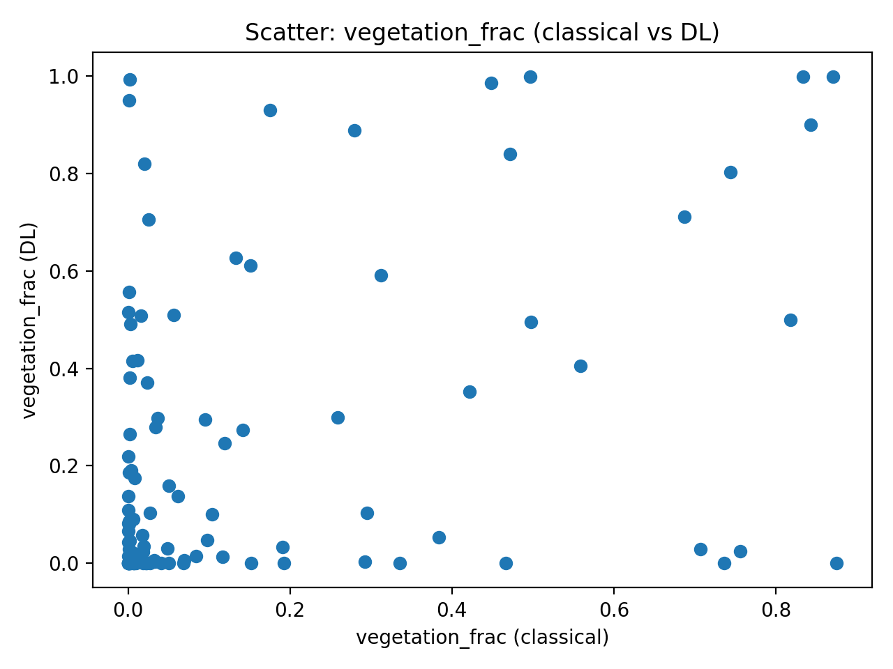
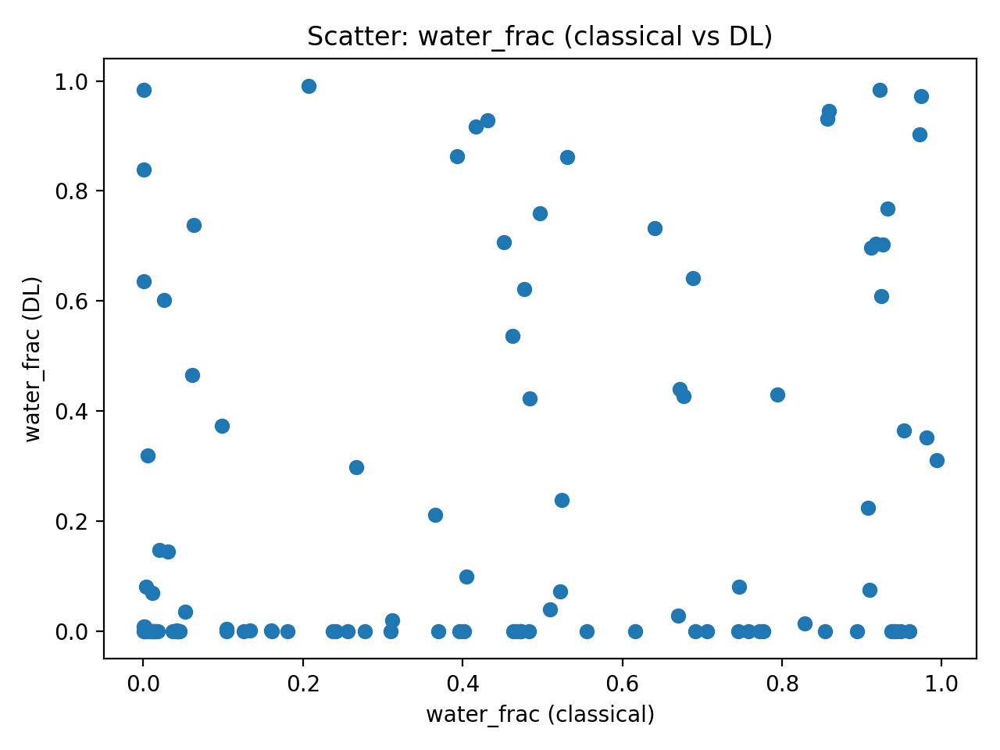

# Eagle Habitat Image Analysis

An independent Python project comparing classical color-based segmentation with pretrained SegFormer deep learning in original bald eagle photographs taken across multiple years.

The main comparison examines the fraction of visible pixels classified as vegetation or water. Both methods use the bottom 65% of each image to reduce the influence of sky.

## Methods

- **Classical segmentation:** Applies RGB and HSV color rules to classify vegetation, water, snow/ice, and sky.
- **Deep-learning segmentation:** Uses the pretrained `nvidia/segformer-b0-finetuned-ade-512-512` model and groups its ADE20K labels into environmental categories. The model was not trained from scratch for this project.
- **Comparison and audit:** Measures agreement using correlations and mean absolute differences, generates figures, and identifies photographs with the largest vegetation and water disagreements.

## Repository files

| File or folder | Purpose |
|---|---|
| `classical v3.py` | Classical segmentation and per-image measurements |
| `segformer_segmentation.py` | SegFormer inference and per-image measurements |
| `compare_classical_vs_dl.py` | Comparison statistics, merged results, and figures |
| `audit_disagreements_106.py` | Lists the largest differences between methods |
| `requirements.txt` | Python dependencies |
| `results_final/` | Research report, final CSV results, audit files, and figures |

## Report and results

- [Research report](<results_final/Eagle Habitat Image Analysis Report.pdf>)
- [Comparison summary](results_final/comparison_summary.csv)
- [Per-image comparison](results_final/merged_per_image.csv)
- [Yearly means](results_final/year_means_compare.csv)
- [Disagreement audit](results_final/audit_top_disagreements.csv)
- [Audit notes](results_final/audit_notes.txt)
- [Figures](results_final/figures/)

### Vegetation comparison



### Water comparison



## Installation

From the repository folder, install the dependencies:

```bash
python -m pip install -r requirements.txt
```

The first SegFormer run requires an internet connection to download the pretrained model.

## Run an analysis

Place your JPG, PNG, or TIFF photographs in a local `photos` folder. The original photograph collection is not included in this repository.

Run these commands from the repository folder:

```bash
python "classical v3.py" --input_dir photos --output_dir outputs_classical_v3 --recursive --roi_bottom_frac 0.65
python segformer_segmentation.py --input_dir photos --output_dir outputs_dl --recursive --roi_bottom_frac 0.65
python compare_classical_vs_dl.py --classical_csv outputs_classical_v3/per_image.csv --dl_csv outputs_dl/per_image.csv --out_dir outputs_compare_roi065_106
python audit_disagreements_106.py
```

The comparison output directory matches the path currently used by the audit script. These commands generate new outputs; the archived final results remain in `results_final/`.

Preserve original capture dates when studying yearly trends. Both analyzers accept `--exiftool_path` for metadata extraction; file modification dates can change when photographs are copied or converted.

## Interpretation

These estimates describe the composition of the photographed scene. They do not directly measure total habitat area or eagle population changes. Framing, lighting, season, and classification errors can affect the estimates. Agreement between methods does not establish accuracy without independently labeled reference data.

## Author

Leo Chen
